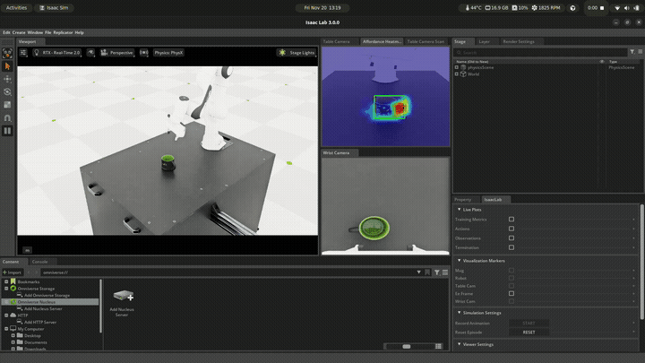
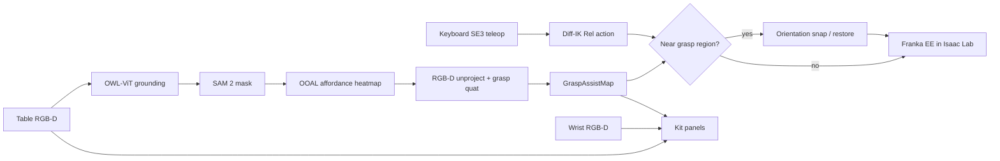

# TeleAssist

**A perception-guided Cartesian teleoperation assistant for a Franka arm in Isaac Lab**



[Full demo (WebM)](teleassist/assets/teleassist_demo.webm) — orientation snap toward the mug grasp region during SE(3) teleop.

## Abstract

Human teleoperation is often treated as pure joystick control: the operator supplies every translation and rotation, and the robot simply tracks the commanded end-effector motion. This package explores a lighter alternative for tabletop grasping: keep the human in the loop for motion, but assist orientation near objects using a scanned scene model. TeleAssist runs in NVIDIA Isaac Lab with a Franka arm and parallel gripper. On start (and on demand), it builds a **GraspAssistMap** from the table RGB-D camera using OWL-ViT grounding, Segment Anything 2 (SAM 2) masks, OOAL affordance heatmaps, and RGB-D grasp geometry. While the operator teleops with relative SE(3) keyboard control, **orientation snap** blends the end-effector toward each object’s estimated grasp quaternion when the hand approaches the grasp region, and restores the pre-snap orientation when the hand leaves.

TeleAssist does not plan language skills or call a motion planner for the human; it assists teleop.

## Research motivation

Tabletop teleoperation fails in predictable ways when the grasp approach must be precise: the operator can reach the object easily in position space, yet still fight the wrist into a side or top-down orientation under limited camera views. PseudoVLA attacks the autonomous stack (language → plan → perception → cuRobo). TeleAssist asks a complementary question in Isaac Lab:

1. **Can the same perception stack support assistive teleop?** Reuse open-vocabulary grounding, segmentation, affordance heatmaps, and grasp geometry without committing the operator to autonomous execution.
2. **Can assist remain local and reversible?** Orientation help should engage near a grasp region, fade with distance, and restore the operator’s prior wrist pose when backing away—not permanently hijack the end-effector orientation.
3. **Can Lab teleop and Kit visualization stay inspectable?** Table and wrist cameras, scan overlays, and snap logs should make it obvious why assist engaged and what quaternion it is targeting.

## System overview

TeleAssist is a single interactive loop: Lab SE(3) keyboard teleop, optional GraspAssistMap rescans, Kit image panels, and orientation snap in the Diff-IK relative action path.



### Teleoperation and assist

- **SE(3) keyboard teleop:** Isaac Lab relative Diff-IK control (7D: Δxyz, rotation vector, gripper). Arm motion is scaled by the task’s Diff-IK action scale.
- **GraspAssistMap:** Per-object entries store world center, dims, affordance label, OOAL grasp points, grasp style, and grasp quaternion (world `wxyz`).
- **Orientation snap:** When the end-effector is within the snap radius of the grasp region (mean OOAL grasp points, tracked with the live rigid-body pose when available), the assist target slerps from the pre-snap orientation toward the grasp quaternion. Outside the radius, assist restores the stored baseline orientation, then idles. Toggle with `O`.
- **Rescan / reset:** `P` rebuilds the map from a fresh table frame; `R` resets the Lab env, reseats the mug, and rescans.

The assist does not invent translation goals, open-loop grasps, or collision-free plans. The operator remains responsible for approach, contact, and gripper timing.

### Perception

- **OWL-ViT** grounds catalog phrases (currently `mug`) in the table-camera image.
- **SAM 2** segments each grounded box.
- **OOAL affordance prediction** builds a heatmap for the catalog affordance (e.g. `hold`) inside the mask and seeds grasp pixels; if OOAL is unavailable, the scan falls back to sampling the full mask.
- **RGB-D geometry** unprojects grasp pixels with Lab camera intrinsics and ROS pose (`quat_w_ros` as Lab `xyzw`), estimates object pose, and computes an adaptive grasp orientation (`side` / `tilted` / `top_down`).
- **Table and wrist cameras** provide a global scan view and a live manipulator view. Scan and heatmap overlays use the table camera; the wrist panel is live RGB only.

SAM 2 is released after each scan to reduce GPU memory use. OOAL is optional grasp-region guidance, not a general detector.

### Scene and cameras

The Lab task reuses the Franka cube-stack base, replaces stacking cubes with the kitchen mug USD, and registers `TeleAssist-Mug-Plate-Franka-IK-Rel-RGBD`. The plate is temporarily omitted. Sensors:

| Sensor | Resolution | Role |
| --- | --- | --- |
| `table_cam` | 480×480 RGB-D | Scan + live / heatmap / overlay panels |
| `wrist_cam` | 256×256 RGB-D | Live wrist panel on `panda_hand` |

## Current progress

The package currently contains:

- A runnable Isaac Lab SE(3) keyboard teleop path for Franka with Diff-IK Rel control.
- A kitchen-style mug scene derived from Lab’s stack task, with seating on the table from live AABB.
- GraspAssistMap scanning (OWL-ViT + SAM 2 + optional OOAL + grasp orientation) on start, `P`, and post-`R`.
- Orientation snap with baseline capture, distance-weighted blend to the grasp quat, and restore on leave.
- Four Kit image panels (table live, affordance heatmap, scan overlay, wrist live), with OpenCV fallback.
- Table and wrist RGB-D sensors; wrist parented under the Franka hand via Lab’s Geometry-aware prim regex.
- Unit tests for scan geometry and snap / restore behavior.

The project is active. Perception quality depends on viewpoint, depth, and OOAL availability; snap thresholds and side-grasp tilt are engineering defaults, not learned policies. There is no language planner, CoTracker loop, or cuRobo path in TeleAssist today.

## Repository structure

| Path | Responsibility |
| --- | --- |
| [`scripts/teleop_franka_se3.sh`](./scripts/teleop_franka_se3.sh) | Launcher (`isaaclab.sh -p`, env vars, CUDA 13 loader path) |
| [`scripts/teleop_assist.py`](./scripts/teleop_assist.py) | Teleop loop, scan triggers, snap, Kit panels |
| [`scripts/verify_lab_kit.sh`](./scripts/verify_lab_kit.sh) / [`verify_lab_kit.py`](./scripts/verify_lab_kit.py) | Kit smoke test |
| [`teleassist/envs/`](./teleassist/envs/) | RGB-D Franka IK-Rel gym task, mug spawn, seat event, cameras |
| [`teleassist/catalog.py`](./teleassist/catalog.py) | Table object phrases, affordances, grasp styles |
| [`teleassist/grounding.py`](./teleassist/grounding.py) | OWL-ViT object grounding |
| [`teleassist/sam.py`](./teleassist/sam.py) | SAM 2 region segmentation |
| [`teleassist/affordance.py`](./teleassist/affordance.py) | OOAL heatmaps and grasp-region pixels (no Tev1) |
| [`teleassist/geometry_scan.py`](./teleassist/geometry_scan.py) | Lab unproject, object pose, adaptive grasp orientation |
| [`teleassist/camera_lab.py`](./teleassist/camera_lab.py) | Read table / wrist Lab camera buffers |
| [`teleassist/scan.py`](./teleassist/scan.py) | GraspAssistMap builder |
| [`teleassist/snap.py`](./teleassist/snap.py) | Orientation snap, baseline memory, restore |
| [`teleassist/view.py`](./teleassist/view.py) | Kit / OpenCV camera panels |
| [`tests/`](./tests/) | Geometry and snap unit tests |

Shared perception assets are expected next to this package inside the parent [pseudo-vla](../README.md) checkout (`../checkpoints/`, `../OOAL/`).

## Scene and supported objects

| Scene | Surface | Catalog objects | Notes |
| --- | --- | --- | --- |
| Lab table (default task) | `table` | `mug` | Plate temporarily removed; mug uses `hold` + `side` grasp |

Gym id: `TeleAssist-Mug-Plate-Franka-IK-Rel-RGBD` (name retained from the earlier mug+plate milestone).

## Setup

TeleAssist depends on NVIDIA Isaac Lab 3.0 (Isaac Sim 6.2), the shared `ps_vla` conda environment used by PseudoVLA, and GPU-based perception packages. Installing Lab into that env can change shared dependencies used by other projects.

### Environment and dependencies

```bash
conda activate ps_vla
cd /path/to/TeleAssist
pip install -e .
# OWL-ViT / transformers pin (Lab may pull transformers 5.x):
pip install 'transformers>=4.46,<5'
```

Isaac Lab should be available at `~/IsaacLab` (`release/3.0.0`) or via `ISAACLAB_PATH`. Accept the Omniverse EULA (launchers set `OMNI_KIT_ACCEPT_EULA=YES`).

SAM 2 and OOAL reuse the parent repo paths by default:

```bash
export TELEASSIST_SAM_CKPT="${TELEASSIST_SAM_CKPT:-../checkpoints/sam2_hiera_base_plus.pt}"
export TELEASSIST_OOAL_ROOT="${TELEASSIST_OOAL_ROOT:-../OOAL}"
# OOAL weights: ../checkpoints/ooal-models/seen_best (or under OOAL/models/checkpoints/)
```

If OOAL is missing, scans still run with full-mask grasp samples; affordance heatmaps will be empty.

### Run

```bash
export OMNI_KIT_ACCEPT_EULA=YES
export ISAACLAB_PATH=~/IsaacLab
cd /path/to/TeleAssist
./scripts/teleop_franka_se3.sh
```

The launcher defaults to `--viz kit` (GUI). Defaults:

| Variable | Default |
| --- | --- |
| `ISAACLAB_PATH` | `~/IsaacLab` |
| `TASK` | `TeleAssist-Mug-Plate-Franka-IK-Rel-RGBD` |
| `TELEOP_DEVICE` | `keyboard` |
| `TELEASSIST_SAM_CKPT` | `../checkpoints/sam2_hiera_base_plus.pt` |
| `TELEASSIST_OOAL_ROOT` | `../OOAL` |

The launcher prepends `site-packages/nvidia/cu13/lib` to `LD_LIBRARY_PATH` when present (Torch CUDA 13 NVRTC).

### Keyboard bindings

Focus the Kit viewport window:

| Keys | Action |
| --- | --- |
| `W` / `S` | Move along X |
| `A` / `D` | Move along Y |
| `Q` / `E` | Move along Z |
| `Z` / `X` | Rotate roll |
| `T` / `G` | Rotate pitch |
| `C` / `V` | Rotate yaw |
| `K` | Toggle gripper |
| `R` | Reset env and rescan |
| `P` | Rescan GraspAssistMap |
| `O` | Toggle orientation snap |

On start (and after `R` / `P`), the table RGB-D camera is scanned. Logs list each object’s center, affordance, grasp quaternion, and point count. Four panels dock to the right of the Kit viewport: **Table Camera**, **Affordance Heatmap**, **Table Camera Scan**, and **Wrist Camera**.

Orientation snap starts within ~30 cm of the grasp region (full strength inside ~12 cm). Distance is to OOAL grasp points (not the mug bbox). Log lines include `[TeleAssist] snap → ...` and `snap restore → ...`. After changing grasp tilt or scan code, press `P` so the map refreshes.

### Tests

```bash
conda activate ps_vla
cd /path/to/TeleAssist
python -m unittest discover -s tests -v
```

These tests cover unprojection / grasp orientation helpers and snap weight, nearest-entry, and restore logic. They do not evaluate OWL-ViT, SAM, OOAL, or end-to-end teleop quality in Lab.

## Limitations and open problems

1. **Narrow scene coverage.** The catalog and seating logic currently assume a single mug on the Lab table. Re-adding the plate or new props needs catalog, spawn, and scan integration.
2. **Simulation-specific validation.** The target is Isaac Lab / Isaac Sim. This is not a hardware driver and has not been validated as a safe real-robot assist.
3. **Visual detection and depth.** Grounding, masks, and unprojection can fail or bias grasp points under occlusion, poor depth, or awkward table-camera viewpoints.
4. **Affordance coverage.** OOAL supports a finite set of seen affordances and needs a separate checkout and checkpoint. Full-mask sampling is a fallback, not equivalent grasp localization.
5. **Grasp orientation defaults.** Side-grasp tilt (`SIDE_GRASP_TILT_DEG`) and snap radii are fixed engineering parameters inherited or tuned by hand, not optimized per object.
6. **Assist authority.** Snap only adjusts rotation in the teleop action. It does not guarantee a collision-free approach, correct contact, or stable grasp once the gripper closes.
7. **No closed-loop tracking yet.** Unlike PseudoVLA, TeleAssist does not run CoTracker online or refine from the wrist camera during approach; the map is static until the next `P` / `R` scan.
8. **Hardware and memory.** Lab rendering plus OWL-ViT, SAM, and OOAL share a GPU; VRAM and CUDA / Lab version skew can limit reproducibility.
9. **Evaluation maturity.** Unit tests cover geometry and snap math. There is no checked-in quantitative teleop-assist benchmark.

## Related work and components

TeleAssist builds on [NVIDIA Isaac Lab](https://isaac-sim.github.io/IsaacLab/), [OWL-ViT](https://github.com/google-research/scenic/tree/main/scenic/projects/owl_vit), [Segment Anything 2](https://github.com/facebookresearch/sam2), and OOAL affordance models, and shares perception assets and design intent with the parent [PseudoVLA](../README.md) prototype. PseudoVLA targets language-conditioned autonomous manipulation in Isaac Sim with cuRobo; TeleAssist targets perception-guided teleop assist in Isaac Lab.
